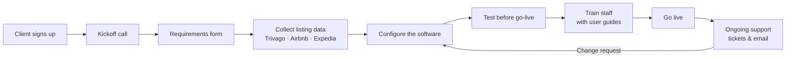
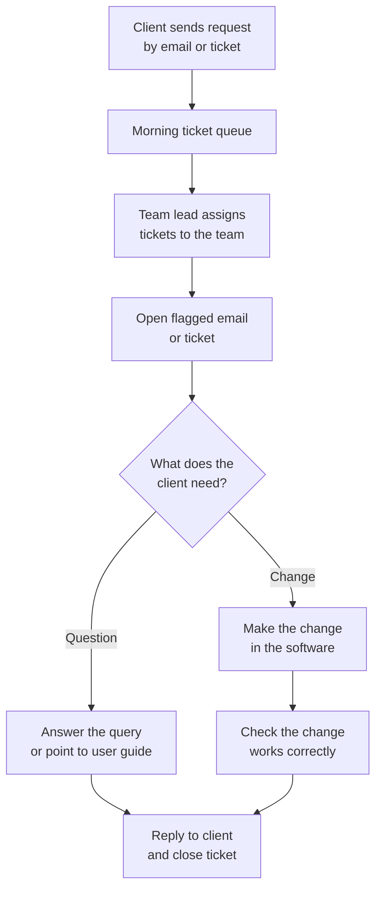

# SaaS Client Onboarding & Support: Process Case Study

How I take a hotel client from signup to go-live on a hotel management software platform, and how I support them after launch. This is a generic, anonymized write-up of my day-to-day work in client implementation and account management. It contains no client names, client data, or company-internal material.

**Role:** Customer Implementation Manager → Senior Onboarding & Account Manager
**Product type:** Hotel management software (SaaS)
**Tools:** Zoho (project tracking), the company's ticket system, email, user guides

---

## The end-to-end process

### 1. Kickoff call
The first conversation with the hotel. I walk through what they need from the software, answer their questions and doubts, and note any changes they want on top of a standard setup, such as extra rooms or different pricing.

### 2. Requirements form
The hotel completes a requirements form so nothing depends on memory or scattered emails. It captures:
- Room types and number of rooms
- Room rates and service charges
- Maximum guests per room
- Food and beverage menus and prices

### 3. Collecting listing data
I pull the hotel's existing listings from **Trivago, Airbnb, and Expedia** and compare them against the form, so the setup matches what guests already see online.

### 4. Configuring the software
I set up the hotel's account: rooms, room types, rates, service charges, occupancy limits, and menus. The onboarding itself is tracked as a project in **Zoho**, so the team can see where each client stands.

### 5. Testing before go-live
Before launch, I make **test bookings** to confirm the setup works end to end: the right rooms appear, prices calculate correctly, and charges are applied as configured.

### 6. Training staff
Hotel staff are trained using **user guides** that walk through the tasks they'll do every day, so they can work independently after launch and refer back when needed.

### 7. Go-live
The hotel starts taking real bookings on the platform.

---

## After go-live: support and change requests

Most of the long-term work happens after launch. Hotels regularly need changes: adding a room, updating a room price, changing a menu price, or asking how to do something.

**How the daily workflow runs:**
1. Requests come in through the **ticket system** and **email**.
2. Each morning, the team lead reviews the queue and **assigns tickets** across the team.
3. Assigned emails are **flagged** so it's clear who owns each one.
4. I open each request and work out what the client needs: a **query** (how do I…?) or a **change** (please update…).
5. Queries get an answer or a pointer to the right section of the user guide. Changes get made in the software and checked before I reply.
6. I confirm with the client and close the ticket.

---

## Beyond individual clients

- **Documentation:** wrote SOPs and process playbooks so onboarding is done the same way every time.
- **Mentoring:** helped new team members learn the onboarding and ticket workflow.
- **Tracking:** monitored adoption, NPS, churn, and time-to-value to spot clients who were struggling.

---

## What this work taught me

- **A form beats a conversation for data.** Collecting requirements in a structured form cuts down on back-and-forth and missed details.
- **Test like a guest.** A test booking catches problems that a quick look at the settings won't.
- **Good guides reduce tickets.** When staff have clear user guides, many questions never become tickets at all.
- **Clear ownership keeps support moving.** Assigning and flagging every request means nothing sits unanswered.

---

## Files in this repo

| File | What it is |
|---|---|
| `README.md` | This case study |
| `onboarding-checklist.md` | A reusable checklist covering every onboarding step |
| `ticket-triage-guide.md` | A short guide to handling incoming support requests |

## Author

**Mahenoor Pathan** · [LinkedIn](https://www.linkedin.com/in/mahenoorpathan) · [GitHub](https://github.com/mahenoorpathan)
